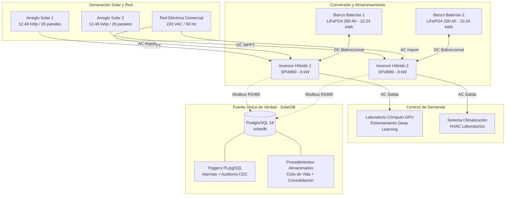
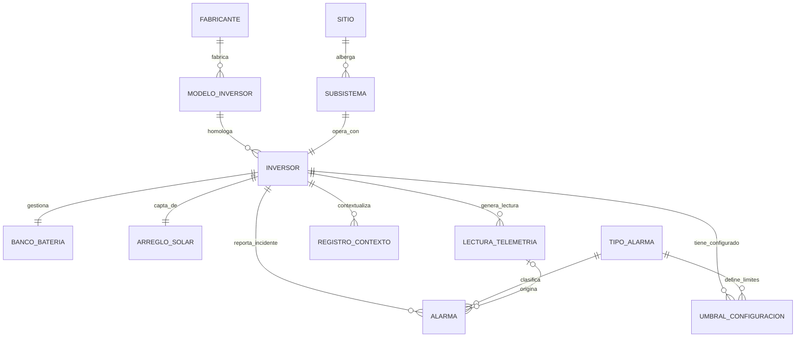

# SolarDB: Base de Datos para la Telemetría de una Microrred Híbrida

[](https://www.postgresql.org/)
[](https://dbeaver.io/)
[](https://doi.org/10.5281/zenodo.21436223)
[](LICENSE)
[](docs/09_proteccion_datos_personales.md)

Proyecto final del curso **Bases de Datos I** (Grupo 811 · Semestre 2026-II)  
**Institución Universitaria Pascual Bravo**  
**Departamento de Sistemas Digitales**  
**Docente:** Ramiro Grisales Montoya  

**Integrantes:**
- Camilo Velásquez Botero
- Emmanuel Echeverry
- Deivy Gómez
- Miguel Borja

---

## 🎯 Línea de Profundización Elegida
> ### **Línea 5: SolarDB: Funciones, Procedimientos y Triggers en PL/pgSQL para Alarmas y Auditoría**
> Implementación integral de una capa procedural en PostgreSQL que automatiza:
> 1. **Detección y Disparo de Alarmas en Tiempo Real**: Triggers reactivos que evalúan telemetría física (SoC crítico, subtensión, sobretensión, sobrecorriente, sobrecalentamiento y pérdida de red) con supresión de tormentas de alarmas (*alarm storm suppression*).
> 2. **Auditoría Forense Inmutable (Change Data Capture - CDC)**: Captura automática en `JSONB` de tuplas completas (`OLD` y `NEW`), diferencias operadas, usuario PostgreSQL, rol de sesión y dirección IP del cliente.
> 3. **Gestión del Ciclo de Vida de Incidentes**: Procedimientos almacenados transaccionales (`CALL`) para transiciones de estado (`ACTIVA` $\to$ `EN_REVISION` $\to$ `RESUELTA` / `DESCARTADA`), resolución masiva y consolidación de resúmenes diarios.
> 4. **Protección de Datos Personales (Ley 1581 de 2012)**: Trigger de saneamiento automático que ofusca rutas de usuario, comandos con credenciales y correos en registros de contexto.

---

## 🏗️ Arquitectura de la Microrred Física

La microrred opera en el campus universitario **CUHK-Shenzhen** y consta de dos subsistemas energéticos autónomos:
- **Subsistema 1 (Cómputo Científico e IA)**: Inversor 1 alimentando estaciones de trabajo GPU/CPU.
- **Subsistema 2 (Climatización HVAC)**: Inversor 2 alimentando bombas de calor y ventilación.



---

## 📊 Modelo Conceptual Entidad-Relación (MER)



---

## ⚡ Formato Ancho vs Formato Largo (Decisión de Ingeniería)
Se adoptó de forma justificada el **Formato Ancho Estructurado** para la tabla `telemetria.lecturas`:
- **Ahorro masivo de almacenamiento**: Evita el overhead de tuplas de PostgreSQL (27 bytes fijos por fila), reduciendo el tamaño en disco de **1.4 GB a solo 162 MB** para más de un millón de registros.
- **Rendimiento analítico**: Permite calcular balances de potencia instantáneos (`P_pv - P_salida + P_red`) directamente en una fila sin requerir costosos `SELF JOIN` ni agregaciones pivotadas.
- **Restricciones CHECK multivariable**: Permite validar consistencia instantánea en el motor (`CHECK (potencia_activa_salida_w <= potencia_aparente_salida_va)`).

---

## 📂 Estructura del Repositorio

```text
.
├── README.md                                    # Documentación principal del proyecto
├── .gitignore                                   # Exclusión de binarios, credenciales y datos crudos
├── sql/                                         # Scripts SQL modulares y ejecutables en orden
│   ├── 00_crear_base.sql                        # Creación de base de datos solardb (UTF-8)
│   ├── 01_esquema_ddl.sql                       # Esquemas, tablas, dominios, PKs, FKs y CHECKs
│   ├── 02_catalogos_dml.sql                     # Catálogos maestros, variables y umbrales base
│   ├── 03_linea5_triggers_funciones_procedimientos.sql # Funciones, triggers y procedimientos PL/pgSQL
│   ├── 04_carga_datos.sql                       # Comandos de carga masiva (\copy) e idempotencia
│   ├── 05_consultas_negocio.sql                 # 11 consultas de negocio analíticas (C1 a C11)
│   ├── 06_pruebas_linea5_sustentacion.sql       # Batería interactiva de pruebas para sustentación
│   ├── 07_indices_vistas_explain.sql            # Índices optimizados, vistas de negocio y EXPLAIN
│   └── 08_verificacion_integridad.sql           # 15 controles automatizados de integridad (todos OK)
├── etl/                                         # Pipeline ETL de extracción, limpieza y verificación
│   ├── requirements.txt                         # Dependencias de Python (psycopg2, zstandard, reportlab)
│   ├── verificar_dataset.py                     # Verificación criptográfica SHA-256 de Zenodo
│   └── etl_opencem.py                           # Extractor y limpiador (corrección artefacto Modbus)
├── docs/                                        # Capítulos monográficos de documentación técnica
│   ├── 01_analisis_y_reglas_negocio.md          # Dominio, equipos, entidades y reglas
│   ├── 02_diagnostico_fuente_calidad.md         # Diagnóstico de calidad y conteos reales
│   ├── 03_modelo_conceptual_mer.md              # Modelo conceptual MER, cardinalidad y semántica
│   ├── 04_modelo_relacional_logico.md           # Esquema relacional y justificación formato ancho
│   ├── 05_normalizacion_3fn.md                  # Proceso formal de normalización hasta 3FN/BCNF
│   ├── 06_diccionario_de_datos.md               # Diccionario exhaustivo y deducción de unidades
│   ├── 07_linea5_alarmas_y_auditoria.md         # Especificación técnica de la Línea 5
│   ├── 08_consultas_de_negocio.md               # Detalle, código y explicación de consultas C1 a C11
│   ├── 09_proteccion_datos_personales.md        # Análisis de cumplimiento de la Ley 1581 de 2012
│   └── 10_guia_reproduccion_sustentacion.md     # Guía paso a paso y preguntas de sustentación
└── entrega/                                     # Entregables finales del curso
    └── G811_BDI_Taller6_Velasquez_Echeverry_Gomez_Borja.pdf # Informe académico final en PDF con portada
```

---

## 🚀 Guía de Reproducción Rápida desde Cero

### 1. Clonar el Repositorio
```bash
git clone https://github.com/CamiloVelasquezBotero/solardb-microrred-postgresql.git
cd solardb-microrred-postgresql
```

### 2. Generar o Verificar los Datos Limpios
```bash
pip install -r etl/requirements.txt
python etl/verificar_dataset.py
python etl/etl_opencem.py --filas 1050000
```

### 3. Ejecutar los Scripts SQL en DBeaver (en orden numérico)
1. Conectado a la base `postgres`: Ejecutar `sql/00_crear_base.sql`.
2. Conectarse a la nueva base `solardb`:
   - Ejecutar `sql/01_esquema_ddl.sql`
   - Ejecutar `sql/02_catalogos_dml.sql`
   - Ejecutar `sql/03_linea5_triggers_funciones_procedimientos.sql`
   - Ejecutar `sql/04_carga_datos.sql` (Carga masiva de 1,050,000 lecturas mediante `\copy`)
   - Ejecutar `sql/05_consultas_negocio.sql`
   - Ejecutar `sql/06_pruebas_linea5_sustentacion.sql` (Verificación interactiva de Línea 5)
   - Ejecutar `sql/07_indices_vistas_explain.sql` (Índices y planes `EXPLAIN ANALYZE`)
   - Ejecutar `sql/08_verificacion_integridad.sql` (Certificación: 15/15 controles en **OK**)

---

## 🔒 Manejo Responsable de la Información (Ley 1581 de 2012)
- Toda anotación de contexto es evaluada por el trigger `trg_sanitizar_contexto_habeas_data`, el cual ofusca automáticamente rutas absolutas locales (`C:\Users\nombre\...`), oculta credenciales y tokens en comandos de terminal y enmascara correos electrónicos.
- El repositorio está totalmente libre de credenciales, contraseñas y cadenas de conexión.

---

## 📚 Cita Obligatoria del Dataset
> Bartels, T. S., Wu, R., Lu, X., Chen, Y., Lu, Y., Xia, F., Yang, H., Chen, Y., & Li, T. (2026). *OpenCEM: Multimodal photovoltaic and battery microgrid dataset with context records and sky imagery* (Version 1.0.0) [Dataset]. Zenodo. [https://doi.org/10.5281/zenodo.21436223](https://doi.org/10.5281/zenodo.21436223)
