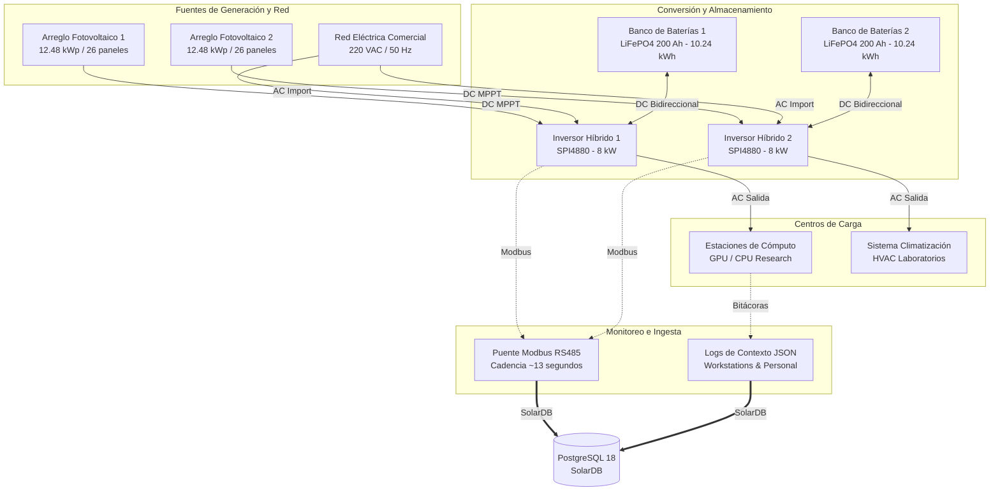

# 1. Análisis del Dominio y Reglas de Negocio

## 1.1 Contexto Operacional de la Microrred Híbrida
Un campus universitario de investigación (**CUHK-Shenzhen**) opera una microrred híbrida inteligente diseñada para maximizar el aprovechamiento de fuentes de energía renovable, reducir la huella de carbono y garantizar la resiliencia energética ante contingencias de la red eléctrica comercial. 

El sistema físico se compone de dos subsistemas energéticos totalmente independientes, cada uno operado por su propio inversor híbrido bidireccional y alimentando perfiles de carga disímiles:
- **Subsistema 1 (Cómputo Científico e Inteligencia Artificial)**: Alimenta estaciones de trabajo equipadas con procesadores multinúcleo y aceleradores gráficos (GPUs NVIDIA) destinadas al entrenamiento de redes neuronales convolucionales (CNNs), modelos de lenguaje (LLMs) y compilación masiva de código científico. Presenta picos de potencia abruptos asociados a las tareas de cálculo.
- **Subsistema 2 (Climatización y Ventilación de Precisión - HVAC)**: Alimenta bombas de calor, manejadoras de aire y unidades compresoras encargadas del acondicionamiento térmico de laboratorios y oficinas. Su consumo está fuertemente correlacionado con la temperatura exterior y la radiación solar diurna.

---

## 1.2 Componentes del Sistema Físico
| Componente | Especificación Técnica | Función en la Microrred |
|---|---|---|
| **Arreglos Fotovoltaicos** | 2 arreglos de 26 paneles monocristalinos PERC de 480 Wp (12.48 kWp c/u, orientación sur, inclinación 22°). | Generación eléctrica primaria renovable durante horas diurnas mediante seguimiento del punto de máxima potencia (MPPT). |
| **Inversores Híbridos** | 2 inversores híbridos bidireccionales SPI4880V150-500P (potencia nominal 8 kW / 8 kVA, 220 VAC, 50 Hz). | Conversión DC/AC y AC/DC, sincronización con red, gestión de prioridades de flujo de potencia e interfaz de telemetría Modbus/RS485. |
| **Bancos de Baterías** | 2 bancos de celdas de litio LiFePO4 de 200 Ah a 51.2 VDC nominal (capacidad de almacenamiento nominal: 10.24 kWh c/u). | Amortiguación de variabilidad solar, almacenamiento de excedentes y respaldo ininterrumpido en caso de pérdida de red pública. |
| **Enlace a Red Pública** | Acometida comercial monofásica/bifásica a 220 VAC nominal, 50 Hz. | Respaldo en caso de déficit solar o agotamiento de la reserva de batería. |
| **Cargas Atendidas** | Subsistema 1: Estaciones de cómputo GPU. Subsistema 2: Climatización HVAC. | Demanda de energía activa y aparente de los usuarios del campus. |

---

## 1.3 Identificación de Entidades y Atributos Principales
A partir del análisis técnico de los equipos y las lecturas Modbus se identificaron las siguientes entidades:
1. **Sitio**: Campus o localización física (`codigo`, `nombre`, `institucion`, `latitud`, `longitud`, `zona_horaria`).
2. **Fabricante**: Proveedor del equipamiento industrial (`nombre`, `pais_origen`, `contacto_soporte`).
3. **Modelo de Inversor**: Ficha técnica de homologación (`codigo_modelo`, `potencia_nominal_w`, `tension_nominal_ac`, `corriente_max_carga`).
4. **Subsistema**: Unidad funcional autónoma (`codigo`, `nombre`, `tipo_carga_principal`, `fecha_puesta_marcha`).
5. **Inversor**: Instancia de hardware instalada (`id`, `numero_serie`, `direccion_modbus`, `firmware_version`, `ubicacion`).
6. **Banco de Baterías**: Conjunto electroquímico acoplado (`quimica`, `capacidad_ah`, `tension_nominal_v`, `soc_minimo`, `soc_critico`).
7. **Arreglo Solar**: Generador fotovoltaico acoplado (`numero_paneles`, `potencia_wp`, `azimut`, `inclinacion`).
8. **Lectura de Telemetría**: Tupla temporal de variables físicas instantáneas (`fecha_hora`, `tension_bateria`, `corriente_bateria`, `soc`, `potencia_pv`, `potencia_salida`, `potencia_red`, `temperaturas`).
9. **Registro de Contexto**: Bitácora semiestructurada de eventos operacionales (`fecha_inicio`, `fecha_fin`, `origen`, `tipo_tarea`, `payload_json`).
10. **Tipo de Alarma**: Catálogo de contingencias parametrizadas (`codigo`, `nombre`, `severidad`, `parametro_evaluado`, `accion_recomendada`).
11. **Umbral de Configuración**: Límites de disparo ajustables por equipo (`inversor_id`, `umbral_warning`, `umbral_critical`).
12. **Alarma Operativa**: Evento anómalo generado automáticamente (`fecha_deteccion`, `severidad`, `valor_detectado`, `estado`, `fecha_resolucion`).
13. **Registro de Auditoría**: Bitácora inmutable de Change Data Capture (`fecha_hora`, `usuario`, `accion`, `tabla`, `datos_anteriores`, `datos_nuevos`).

---

## 1.4 Reglas del Negocio (RN)
1. **RN-01 (Identidad y Cardinalidad de Inversores)**: Existen exactamente dos inversores lógicos identificados como `1` y `2`, cada uno asignado exclusivamente a un único subsistema funcional (`1: Cómputo`, `2: Climatización`).
2. **RN-02 (Prioridad de Despacho de Potencia)**:
   - Toda generación solar fotovoltaica debe destinarse prioritariamente a suplir la demanda instantánea de la carga acoplada.
   - Cualquier excedente de generación solar se destina a recargar el banco de baterías acoplado hasta alcanzar el 100% de SoC.
   - Si la demanda supera la generación solar, el déficit debe cubrirse con la batería hasta que su SoC alcance el umbral mínimo recomendado (20%). Por debajo del 20%, la red pública comercial asume la totalidad del déficit.
3. **RN-03 (Protección Electroquímica de Batería)**:
   - La tensión en bornes de batería debe mantenerse entre 44.0 V (corte de descarga) y 58.4 V (tensión máxima de protección).
   - Un SoC $\le 20\%$ genera automáticamente una alarma de **ADVERTENCIA** (`WARNING`).
   - Un SoC $\le 10\%$ genera automáticamente una alarma **CRÍTICA** (`CRITICAL`), exigiendo desconexión de cargas o recarga de emergencia.
4. **RN-04 (Protección Térmica de Inversores)**:
   - Una temperatura de semiconductores IGBT (`temper1`) $\ge 50.0^\circ\text{C}$ dispara alarma de advertencia.
   - Una temperatura $\ge 60.0^\circ\text{C}$ dispara alarma crítica y obliga a reducción de potencia (*derating*).
5. **RN-05 (Detección de Operación en Isla)**:
   - Si la tensión de red pública cae por debajo de 50.0 V, el sistema debe registrar el evento informativo de paso a **Modo Isla**.
6. **RN-06 (Unicidad y Resolución Temporal)**:
   - No puede existir más de una lectura de telemetría para el mismo inversor en el mismo instante de tiempo (`UNIQUE (inversor_id, fecha_hora)`).
7. **RN-07 (Trazabilidad Forense Inmutable)**:
   - Ninguna modificación o eliminación sobre registros de configuración, equipos o umbrales puede ocurrir sin ser registrada automáticamente en la bitácora de auditoría en formato JSONB.
8. **RN-08 (Cumplimiento de Privacidad - Ley 1581 de 2012)**:
   - Los registros de contexto provenientes de estaciones de cómputo no deben almacenar nombres de usuario de cuentas locales en rutas de sistema de archivos ni credenciales en comandos. Toda ruta debe ser ofuscada antes de su almacenamiento definitivo.
