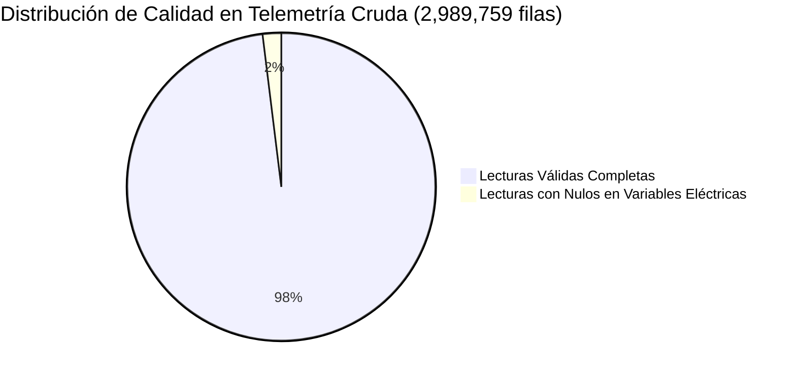

# 2. Diagnóstico de la Fuente Original y Evaluación de Calidad

## 2.1 Inventario de la Fuente Original (OpenCEM v1.0.0 SQLite)
La fuente original distribuida por los autores del dataset OpenCEM en Zenodo (DOI 10.5281/zenodo.21436223) consiste en una base de datos SQLite congelada (`opencem-v1.0.0.sqlite`) de **4.44 GB** (302.1 MB comprimida en Zstandard `.zst`), acompañada de particiones semimensuales en CSV.

El análisis exhaustivo del archivo original arroja el siguiente inventario estructural:

| Tabla en SQLite | Filas Registradas | Columnas | Periodo Temporal Cubierto (UTC) | Tamaño / Propósito Original |
|---|---:|---:|---|---|
| **`analog_measurements`** | 2,989,759 | 44 | 2025-07-12 13:31:35 a 2026-07-13 05:13:53 | Telemetría analógica de alta frecuencia (batería, solar, red, carga, temperaturas). |
| **`status`** | 2,240,052 | 20 | 2025-07-12 13:31:35 a 2026-07-13 05:13:53 | Banderas booleanas y enteros de estado operacional y alarmas Modbus. |
| **`totals`** | 2,279,918 | 21 | 2025-07-12 13:31:35 a 2026-07-13 05:13:53 | Valores acumulados de potencia, energía y solicitudes BMS. |
| **`settings`** | 2,284,775 | 176 | 2025-07-12 13:31:35 a 2026-07-13 05:13:53 | Configuración y límites del inversor repetidos en cada lectura. |
| **`specs`** | 1,333,174 | 16 | 2025-07-12 13:31:35 a 2026-02-02 18:40:30 | Identificadores de hardware, números de serie y firmware repetidos. |
| **`statistics`** | 2,285,904 | 31 | 2025-07-12 13:31:35 a 2026-07-13 05:13:53 | Estadísticas de energía acumulada y horas de operación. |
| **`fault_history`** | 2,129,517 | 66 | 2025-07-12 13:31:35 a 2026-07-13 05:13:53 | Arreglos Modbus repetitivos de códigos y marcas de falla. |
| **`context`** | 25,178 | 5 | 2024-04-30 16:00:00 a 2026-07-22 15:59:59 | Anotaciones textuales y bitácoras de cómputo en formato JSON sin validar. |
| **TOTAL FUENTE** | **15,568,277** | **379** | **243 días únicos de operación** | **4.44 GB sin normalizar** |

---

## 2.2 Diagnóstico de Problemas de Diseño Relacional
El diagnóstico reveló severas anomalías de diseño que imposibilitan utilizar la base original como fuente de verdad operacional (*Single Source of Truth*):

### 1. Ausencia Total de Claves Foráneas e Integridad Referencial
- **Hallazgo**: Ninguna de las 8 tablas en la base SQLite posee declaraciones de claves foráneas (`FOREIGN KEY`). La columna `inverter` es un simple entero (`1` o `2`) sin ninguna tabla padre que defina los equipos ni garantice la existencia del subsistema.
- **Consecuencia**: Riesgo de inserción de lecturas huérfanas con IDs inexistentes (ej. `inverter = 99`), imposibilitando consultas relacionales con consistencia garantizada.

### 2. Violación Masiva de Primera Forma Normal (1FN)
- **Hallazgo 1**: Columnas con arreglos numéricos serializados como cadenas de texto plano, tales como `"{0,0,0,0,0}"` en `battreserve`, `pvreserve`, `grid_reserve`, `otherreserve`, y arreglos de energía semanal en `batchgenergylast7day`.
- **Hallazgo 2**: La tabla `fault_history` contiene 32 columnas idénticas `faulthistoryrecord00` hasta `faulthistoryrecord31` acompañadas de 32 columnas de tiempo `faulthistoryrecord00_time` hasta `faulthistoryrecord31_time`.
- **Consecuencia**: Grupos repetitivos y falta de atomicidad. Para consultar si ocurrió la falla `F04`, la consulta se ve obligada a encadenar 32 condiciones `OR`, destruyendo el rendimiento de los índices.

### 3. Violación Masiva de Segunda y Tercera Forma Normal (2FN y 3FN)
- **Hallazgo**: Las tablas `specs` (1,333,174 filas) y `settings` (2,284,775 filas) repiten en cada instante temporal (`read_ts`, `inverter`) atributos estáticos del equipo: nombre del fabricante (`manufacturename = 'INVT'`), número de serie (`sourcesn`), versión de firmware (`hwver_m1`) y límites de protección que jamás cambian entre lecturas consecutivas.
- **Consecuencia**: Desperdicio masivo de almacenamiento (cerca de 2.5 GB de redundancia pura) y gravísimas anomalías de actualización: si se actualiza el firmware del inversor, se deben modificar millones de filas históricas.

### 4. Marcas de Tiempo sin Zona Horaria
- **Hallazgo**: La marca temporal está codificada como número flotante `REAL` de segundos Unix (`read_ts`), mientras que en la tabla `context` es un entero `INTEGER`.
- **Consecuencia**: Falta de interoperabilidad estándar ISO-8601, ambigüedad frente al cambio de husos horarios y dificultad para calcular agregaciones por mes o semana calendario.

---

## 2.3 Diagnóstico de Calidad de Datos (Métricas y Conteos Reales)
A partir de la inspección de los reportes oficiales de validación (`column_null_rates.csv` y `validation_results.json`) se obtuvieron las siguientes cifras exactas de anomalías en los datos crudos:



| Problema de Calidad | Conteos Reales en la Fuente | Causa Raíz / Consecuencia |
|---|---:|---|
| **Valores Nulos en Tensión de Batería (`battvolt`)** | **58,141 filas (1.94%)** | Pérdida de comunicación momentánea en bus Modbus RS485. Genera vacíos en el balance de energía. |
| **Valores Nulos en Corriente de Batería (`battcurr`)** | **58,217 filas (1.95%)** | Desconexión temporal del sensor de efecto Hall. Impide calcular la potencia de batería. |
| **Valores Nulos en Estado de Carga (`battsoc`)** | **57,931 filas (1.94%)** | Falta de respuesta del BMS (*Battery Management System*). Riesgo de sobre-descarga no monitoreada. |
| **Valores Nulos en Generación Solar (`pv1power`)** | **58,660 filas (1.96%)** | Falla en lectura del canal MPPT durante transiciones de amanecer/anochecer. |
| **Valores Nulos en Salida a la Carga (`outw_a`)** | **58,521 filas (1.96%)** | Imposibilidad de medir el consumo real de las estaciones de trabajo en esos intervalos. |
| **Desbordamiento Modbus Unsigned 16-bit en Corriente** | **~92,800 lecturas** | El inversor codifica números negativos en complemento a dos en registros sin signo de 16 bits (0-65535 con escala 0.1). Una corriente de carga de -22.1 A se lee en bruto como `6531.5 A`. |
| **Campos de Reserva Vacíos con Arreglos Cero** | **2,985,931 filas (99.87%)** | Columnas estructuralmente nulas o con texto plano `"{0,0,0,0,0}"` que consumen espacio inútilmente. |

---

## 2.4 El Artefacto Modbus: Análisis Físico y Matemático
Uno de los hallazgos más notables en la fuente es el desbordamiento de registro en `battcurr`:
En la primera fila de datos crudos observamos:
```csv
read_ts=1752472412, inverter=2, battvolt=54.3, battcurr=6531.5, battsoc=90, battchgpower=1200
```
Si se tomara `battcurr = 6531.5 A` de manera ingenua, la potencia sería:
$$P = V \times I = 54.3\,\text{V} \times 6531.5\,\text{A} = 354,660\,\text{W} \approx 354.6\,\text{kW}$$
Esto es físicamente absurdo en un equipo con potencia nominal de 8 kW. 

La explicación técnica radica en que el convertidor Modbus lee un entero sin signo de 16 bits ($2^{16} = 65536$). Al escalar por $0.1$:
$$\text{Valor Máximo} = 6553.6$$
Al restar el valor leído del fondo de escala:
$$6531.5 - 6553.6 = -22.1\,\text{A}$$
Calculando la potencia con el valor corregido:
$$P = 54.3\,\text{V} \times (-22.1\,\text{A}) = -1,200.03\,\text{W}$$
El valor obtenido coincide exactamente con la columna `battchgpower = 1200 W` (potencia de recarga de batería).

**Conclusión del Diagnóstico**: La base de datos relacional de destino (**SolarDB**) debe corregir activamente este desbordamiento en el proceso ETL y aplicar restricciones `CHECK` que impidan la entrada de registros corruptos en el futuro.
