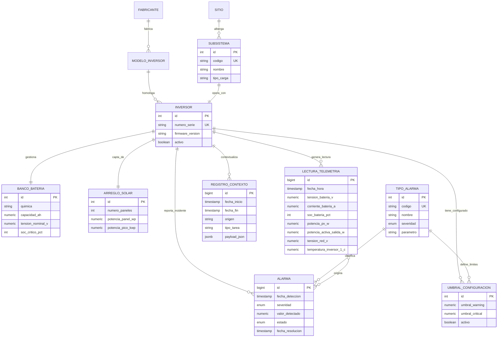

# 3. Modelo Conceptual Entidad-Relación (MER)

## 3.1 Descripción del Modelo Conceptual
El Modelo Conceptual Entidad-Relación (MER) captura las entidades físicas del campus y la microrred, los eventos de telemetría continua y los componentes de gestión de alarmas y auditoría.

### Entidades y Semántica del Negocio
1. **SITIO**: Representa la sede o campus donde opera la instalación energética.
2. **FABRICANTE**: Entidad proveedora de equipos industriales.
3. **MODELO_INVERSOR**: Ficha técnica y características nominales del inversor.
4. **SUBSISTEMA**: Cada una de las dos unidades funcionales independientes de la microrred (Cómputo vs HVAC).
5. **INVERSOR**: La unidad física de conversión bidireccional y nodo de telemetría.
6. **BANCO_BATERIA**: Conjunto de celdas electroquímicas de almacenamiento acopladas al inversor.
7. **ARREGLO_SOLAR**: Sistema de generación fotovoltaica conectado al canal MPPT del inversor.
8. **LECTURA_TELEMETRIA**: Muestra analógica instantánea de variables eléctricas y térmicas.
9. **REGISTRO_CONTEXTO**: Anotación operacional semiestructurada (logs de cómputo y personal).
10. **TIPO_ALARMA**: Catálogo normalizado de incidentes operacionales y umbrales base.
11. **UMBRAL_CONFIGURACION**: Parametrización individual de límites de alarma por inversor.
12. **ALARMA**: Instancia de incidente o anomalía detectada en tiempo real.
13. **REGISTRO_CAMBIOS**: Bitácora de Change Data Capture para auditoría forense.

---

## 3.2 Diagrama MER Conceptual (Notación Pata de Gallo)

---

## 3.3 Relaciones, Cardinalidades y Participación

| Relación | Cardinalidad | Participación | Justificación del Negocio |
|---|:---:|:---:|---|
| **SITIO $\to$ SUBSISTEMA** | $1 : N$ | Total en Subsistema (1..1), Parcial en Sitio (1..N) | Un sitio puede albergar uno o varios subsistemas (el campus CUHK-Shenzhen alberga 2). Cada subsistema pertenece obligatoriamente a un sitio. |
| **MODELO $\to$ INVERSOR** | $1 : N$ | Total en Inversor (1..1), Parcial en Modelo (0..N) | Un modelo de inversor homologado puede ser instalado en varios puntos. Cada inversor físico corresponde exactamente a un modelo de catálogo. |
| **SUBSISTEMA $\to$ INVERSOR** | $1 : 1$ | Total en ambas entidades (1..1) | Cada subsistema funcional autónomo es controlado por un único inversor híbrido bidireccional de 8 kW. |
| **INVERSOR $\to$ BANCO_BATERIA** | $1 : 1$ | Total en Batería (1..1), Total en Inversor (1..1) | Cada inversor híbrido SPI4880 tiene acoplado un banco dedicado de almacenamiento de litio LiFePO4 de 200 Ah. |
| **INVERSOR $\to$ ARREGLO_SOLAR** | $1 : 1$ | Total en Solar (1..1), Total en Inversor (1..1) | Cada inversor opera conectado a su propio arreglo fotovoltaico de 26 paneles (12.48 kWp) vía MPPT. |
| **INVERSOR $\to$ LECTURA_TELEMETRIA** | $1 : N$ | Parcial en Inversor (0..N), Total en Lectura (1..1) | Un inversor genera millones de lecturas a lo largo del tiempo. Cada lectura pertenece indefectiblemente a un inversor. |
| **INVERSOR $\to$ REGISTRO_CONTEXTO** | $1 : N$ | Parcial en Inversor (0..N), Total en Contexto (1..1) | Las estaciones de cómputo y el personal del campus generan bitácoras asociadas al subsistema en el que operan. |
| **TIPO_ALARMA $\to$ UMBRAL** | $1 : N$ | Total en Umbral (1..1), Parcial en Tipo (0..N) | Cada tipo de alarma normalizado se parametriza con umbrales específicos para cada inversor de la microrred. |
| **TIPO_ALARMA $\to$ ALARMA** | $1 : N$ | Total en Alarma (1..1), Parcial en Tipo (0..N) | Cada incidente generado corresponde estrictamente a una categoría o tipo de contingencia predefinida. |
| **LECTURA $\to$ ALARMA** | $1 : N$ (Opcional) | Parcial en Lectura (0..N), Parcial en Alarma (0..1) | Una lectura de telemetría puede disparar cero, una o varias alarmas simultáneas (ej. sobretemperatura y batería baja en el mismo instante). |
