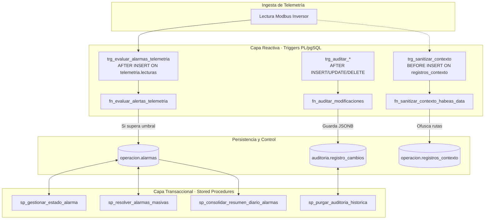
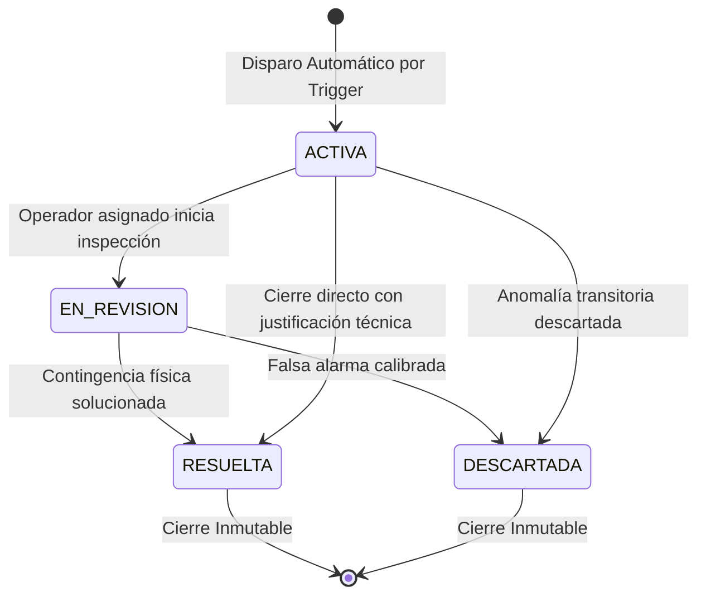

# 7. Línea de Profundización 5: Funciones, Procedimientos y Triggers en PL/pgSQL para Alarmas y Auditoría

## 7.1 Arquitectura del Motor Procedural en PostgreSQL
La **Línea de Profundización 5** transforma a **SolarDB** de un repositorio estático de telemetría a una plataforma activa de supervisión, diagnóstico en tiempo real y gobernanza inmutable de datos. 

La solución implementa una arquitectura desacoplada en tres capas procedimentales dentro del motor PostgreSQL:
1. **Capa Reactiva (Triggers y Funciones de Disparo)**: Inspecciona cada tupla insertada o modificada en tiempo de ejecución, evaluando umbrales de seguridad física y capturando eventos de auditoría forense sin intervención de la aplicación cliente.
2. **Capa Transaccional (Procedimientos Almacenados)**: Gestiona el ciclo de vida de los incidentes, transiciones de estado, cierres masivos, consolidaciones diarias y políticas de retención con soporte nativo de transacciones (`COMMIT` / `ROLLBACK`).
3. **Capa Analítica (Funciones Matemáticas de Negocio)**: Implementa algoritmos de integración numérica trapezoidal para el cálculo de balances energéticos (kWh) directamente en el motor de base de datos.



---

## 7.2 Lógica del Trigger de Alarmas y Supresión de Tormentas
Uno de los mayores desafíos en telemetría de alta frecuencia (~13 s por muestra) es la **tormenta de alarmas** (*alarm storming*): si una batería permanece con SoC del 8% durante 4 horas, un trigger ingenuo generaría más de 1,100 alarmas idénticas en la base de datos, colapsando el sistema de notificaciones y saturando el almacenamiento.

### Algoritmo Implementado en `operacion.fn_evaluar_alertas_telemetria()`:
1. **Extracción Dinámica de Umbrales**: Consulta la tabla `operacion.umbrales_configuracion` para obtener los límites de advertencia y crítico activos para el inversor y parámetro evaluado.
2. **Evaluación Jerárquica**:
   - Si el valor viola el umbral crítico $\implies$ clasifica como `CRITICAL`.
   - Si no es crítico pero viola el umbral de advertencia $\implies$ clasifica como `WARNING`.
3. **Mecanismo de Histéresis Temporal y Desduplicación**:
   Antes de insertar en `operacion.alarmas`, el trigger ejecuta una consulta de existencia:
   ```sql
   SELECT EXISTS (
       SELECT 1 FROM operacion.alarmas 
       WHERE inversor_id = NEW.inversor_id 
         AND tipo_alarma_id = v_tipo_id
         AND estado = 'ACTIVA'
         AND fecha_deteccion >= (NEW.fecha_hora - INTERVAL '15 minutes')
   );
   ```
   Si ya existe un incidente activo de la misma categoría registrado en los últimos 15 minutos (o 30 minutos para advertencias), el trigger **suprime el duplicado**, manteniendo un registro limpio sin saturar la bitácora.

---

## 7.3 Máquina de Estados del Ciclo de Vida de una Alarma
Las alarmas no son simples registros de texto; poseen un ciclo de vida operacional formal controlado por el procedimiento almacenado `operacion.sp_gestionar_estado_alarma()`:



### Reglas de Transición Validadas por el Procedimiento:
- Una alarma en estado `RESUELTA` o `DESCARTADA` **no puede ser reabierta ni modificada** (garantía de inmutabilidad del historial de fallas).
- Toda transición a `RESUELTA` o `DESCARTADA` exige obligatoriamente:
  * Fecha y hora de resolución (`CURRENT_TIMESTAMP`).
  * Nombre del operador responsable (`usuario_resolutor`).
  * Informe técnico circunstanciado de la solución aplicada (`comentario_resolucion`).
- La restricción CHECK `chk_resolucion_consistente` a nivel de tabla valida estas condiciones impidiendo cualquier omisión.

---

## 7.4 Bitácora Inmutable de Auditoría Forense (Change Data Capture en JSONB)
Para garantizar la trazabilidad de cualquier cambio en la configuración de la microrred o eliminación de telemetría histórica, se implementó el trigger `auditoria.fn_auditar_modificaciones()`.

### Ventajas del Enfoque JSONB Implementado:
1. **Esquema Agnóstico**: Una sola función trigger audita cualquier tabla del sistema (`inversores`, `umbrales_configuracion`, `catalogo_tipos_alarma`, `telemetria.lecturas`) sin necesidad de crear tablas de auditoría dedicadas por cada entidad.
2. **Cálculo Automático de Diferencias (*Diff*)**:
   Mediante operadores nativos de PostgreSQL, el trigger compara la imagen `OLD` y `NEW` y genera un objeto JSONB que contiene exclusivamente las columnas alteradas:
   ```json
   {
     "umbral_warning": {"antes": 20.00, "despues": 25.00},
     "umbral_critical": {"antes": 10.00, "despues": 12.00},
     "modificado_por": {"antes": "sistema", "despues": "ingeniero_operaciones"}
   }
   ```
3. **Contexto Forense Completo**: Registra el usuario PostgreSQL (`CURRENT_USER`), el usuario de sesión (`SESSION_USER`), la dirección IP del cliente (`inet_client_addr()`) y la aplicación emisora (`application_name`), impidiendo el repudio de acciones operacionales.

---

## 7.5 Batería de Pruebas y Evidencia de Ejecución en Vivo
El script `sql/06_pruebas_linea5_sustentacion.sql` provee los casos de prueba ejecutables en vivo en DBeaver durante la sustentación:
- **Prueba 1**: Inserción de lectura normal $\implies$ Conteo de alarmas = 0.
- **Prueba 2**: Inserción con SoC = 8% y Temp = 62.5 °C $\implies$ Se generan automáticamente 3 registros en `operacion.alarmas` (Descarga crítica, sobretensión y sobrecalentamiento).
- **Prueba 3**: Modificación de umbral con `UPDATE` $\implies$ Se crea tupla en `auditoria.registro_cambios` con `OLD`, `NEW` y `diferencias`.
- **Prueba 4**: Llamada a `CALL sp_gestionar_estado_alarma(...)` $\implies$ Transición exitosa a `EN_REVISION` y luego `RESUELTA`.
- **Prueba 5**: Inserción de comando con credenciales y rutas de usuario en contexto $\implies$ Trigger ofusca la ruta bajo Ley 1581.
- **Prueba 6**: Inserción de SoC = 185% $\implies$ PostgreSQL aborta la transacción con error `check_violation (chk_telemetria_soc)`.
