# 10. Guía de Reproducción Paso a Paso y Protocolo de Sustentación

## 10.1 Requisitos Previos del Entorno
Para reproducir la base de datos **SolarDB** desde cero se requiere:
1. **Motor de Base de Datos**: PostgreSQL 15, 16, 17 o 18 (Servicio local activo en puerto `5432`).
2. **Cliente de Base de Datos**: DBeaver Community Edition (o `psql` en terminal).
3. **Entorno de Ejecución**: Python 3.10+ con pip (para descompresión y verificación).
4. **Herramienta de Versionamiento**: Git.

---

## 10.2 Flujo de Ejecución en DBeaver (Paso a Paso)

```mermaid
flowchart LR
    S0["00_crear_base.sql\n(Conectado a 'postgres')"] --> S1["01_esquema_ddl.sql\n(Conectado a 'solardb')"]
    S1 --> S2["02_catalogos_dml.sql\n(Poblado maestro)"]
    S2 --> S3["03_linea5_triggers...\n(Lógica procedural)"]
    S3 --> S4["04_carga_datos.sql\n(Carga masiva 1M)"]
    S4 --> S5["05_consultas_negocio.sql\n(Consultas C1 a C11)"]
    S5 --> S6["06_pruebas_linea5...\n(Demostración en vivo)"]
    S6 --> S7["07_indices_vistas...\n(EXPLAIN ANALYZE)"]
    S7 --> S8["08_verificacion_...\n(15 controles OK)"]
```



### Paso 1: Creación de la Base de Datos
1. Abrir **DBeaver**.
2. Conectarse a la conexión existente de mantenimiento de PostgreSQL (base de datos `postgres`, usuario `postgres`).
3. Abrir el script `sql/00_crear_base.sql`.
4. Ejecutar el script (botón *Execute SQL Script* o `Alt + X`).
5. En el panel izquierdo *Database Navigator*, hacer clic derecho sobre la conexión y seleccionar **Refresh** (`F5`). Aparecerá la base de datos `solardb`.

### Paso 2: Conexión a `solardb` y Creación del Esquema DDL
1. En DBeaver, cambiar la base de datos activa a `solardb` (o crear una nueva conexión apuntando a `solardb`).
2. Abrir y ejecutar `sql/01_esquema_ddl.sql`.
3. Se crearán los 4 esquemas (`microrred`, `telemetria`, `operacion`, `auditoria`), tipos enumerados y todas las tablas con sus restricciones.

### Paso 3: Poblado de Catálogos Maestros
1. Abrir y ejecutar `sql/02_catalogos_dml.sql`.
2. Se poblarán los sitios, fabricantes, modelos de inversor, subsistemas, bancos de batería, arreglos fotovoltaicos, catálogo de 21 variables físicas, 11 tipos de alarma y 22 umbrales de configuración.

### Paso 4: Creación de Triggers, Funciones y Procedimientos (Línea 5)
1. Abrir y ejecutar `sql/03_linea5_triggers_funciones_procedimientos.sql`.
2. Se compilan las funciones PL/pgSQL, triggers activos de alarmas, auditoría CDC y Habeas Data, y los procedimientos almacenados de gestión.

### Paso 5: Carga Masiva de Telemetría (> 1,000,000 Lecturas)
1. Abrir y ejecutar `sql/04_carga_datos.sql`.
2. Para cargar el archivo generado en `data/telemetria_lecturas.csv`:
   - **Opción DBeaver GUI**: Clic derecho sobre la tabla `telemetria.lecturas` > *Import Data* > Seleccionar CSV > Mapear columnas > Proceder.
   - **Opción Terminal / psql**:
     ```bash
     psql -U postgres -d solardb -c "\copy telemetria.lecturas(inversor_id, fecha_hora, read_ts_unix, tension_bateria_v, corriente_bateria_a, potencia_bateria_w, soc_bateria_pct, tension_pv_v, corriente_pv_a, potencia_pv_w, tension_salida_v, corriente_salida_a, frecuencia_salida_hz, potencia_activa_salida_w, potencia_aparente_salida_va, porcentaje_carga_pct, tension_red_v, corriente_red_a, frecuencia_red_hz, potencia_red_w, temperatura_inversor_1_c, temperatura_inversor_2_c, temperatura_bateria_c, temperatura_ambiente_c) FROM 'c:/Users/Camilo/Downloads/BD_Antigravity/data/telemetria_lecturas.csv' WITH (FORMAT csv, HEADER true);"
     ```
   - Repetir para `operacion.registros_contexto` con `data/registros_contexto.csv`.

### Paso 6: Ejecución de Consultas de Negocio
1. Abrir y ejecutar `sql/05_consultas_negocio.sql`.
2. Explorar los resultados tabulares de balance energético (C1), hora pico solar (C2), comparación de subsistemas (C3), descargas críticas (C4), completitud (C5) y filtros nativos JSONB (C6 a C11).

### Paso 7: Pruebas de Sustentación en Vivo (Línea 5)
1. Abrir y ejecutar paso a paso `sql/06_pruebas_linea5_sustentacion.sql`.
2. Observar en tiempo real:
   - Inserción nominal $\implies$ sin alarmas.
   - Inserción anómala $\implies$ generación automática de alarmas por trigger.
   - Modificación DML $\implies$ captura de diferencias en `auditoria.registro_cambios`.
   - Llamada a procedimiento `CALL sp_gestionar_estado_alarma(...)` $\implies$ cierre de incidente.
   - Inserción de dato inválido $\implies$ aborto por restricción CHECK.

### Paso 8: Optimización con Índices y Vistas
1. Abrir y ejecutar `sql/07_indices_vistas_explain.sql`.
2. Comprobar los planes de ejecución `EXPLAIN (ANALYZE, BUFFERS)` que demuestran el paso de escaneos secuenciales a escaneos de índice de alto rendimiento.
3. Consultar las vistas de negocio `v_balance_energetico_horario` y `v_tablero_control_alarmas`.

### Paso 9: Certificación de Integridad
1. Abrir y ejecutar `sql/08_verificacion_integridad.sql`.
2. Validar que los **15 controles automatizados** arrojen el estado `'OK'`.

---

## 10.3 Preguntas Típicas del Docente y Respuestas Técnicas de Sustentación

1. **¿Por qué eligieron formato ancho en lugar de formato largo para las lecturas?**
   * *Respuesta*: En telemetría de microrredes industriales, las variables eléctricas se miden simultáneamente en un mismo instante. El formato ancho ahorra más del 80% de almacenamiento en disco al evitar multiplicar por 20 los 27 bytes de sobrecarga fija por tupla de PostgreSQL. Además, permite calcular balances de potencia instantáneos (`P_pv - P_salida + P_red`) directamente en la misma fila sin requerir costosos `SELF JOIN` o pivoteos, y habilita restricciones `CHECK` multivariable instantáneas.
2. **¿Cómo resolvieron el problema de desbordamiento en la corriente de batería de Modbus?**
   * *Respuesta*: El inversor codifica números con signo en registros de 16 bits sin signo (0 a 65535 escalados por 0.1). Cuando la batería se recarga con -22.1 A, el registro almacena $65536 - 221 = 65315$ ($6531.5\text{ A}$). En el proceso ETL detectamos lecturas $> 1000\text{ A}$ y aplicamos la corrección formal $I = \text{valor} - 6553.6\text{ A}$, lo cual fue verificado matemáticamente contra la columna de potencia de recarga `battchgpower`.
3. **¿Cómo evita el trigger de la Línea 5 una tormenta de alarmas en la base de datos?**
   * *Respuesta*: La función trigger `fn_evaluar_alertas_telemetria()` implementa histéresis temporal. Antes de insertar una alarma, verifica con `EXISTS` si ya existe un incidente activo de la misma categoría registrado para ese inversor en los últimos 15 minutos (o 30 minutos para advertencias). Si existe, suprime la inserción redundante.
4. **¿Cómo garantizan el cumplimiento de la Ley 1581 de 2012 en las anotaciones de contexto?**
   * *Respuesta*: Mediante el trigger `trg_sanitizar_contexto_habeas_data`, que antes de persistir cualquier registro en `operacion.registros_contexto`, ejecuta expresiones regulares que ofuscan rutas absolutas de usuario (`C:\Users\nombre\...`), eliminan posibles tokens o contraseñas en comandos y enmascaran correos electrónicos, garantizando el principio de finalidad y minimización de datos.
5. **¿Qué ocurre si intento insertar un Estado de Carga (SoC) del 150% o una tensión negativa?**
   * *Respuesta*: El motor PostgreSQL rechaza la transacción de inmediato arrojando una excepción `check_violation`, gracias a la restricción `chk_telemetria_soc CHECK (soc_bateria_pct BETWEEN 0 AND 100)`, protegiendo la integridad física de la base de datos.
